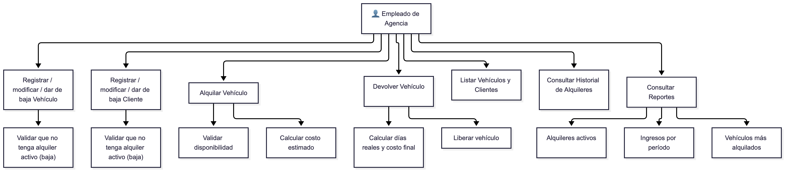
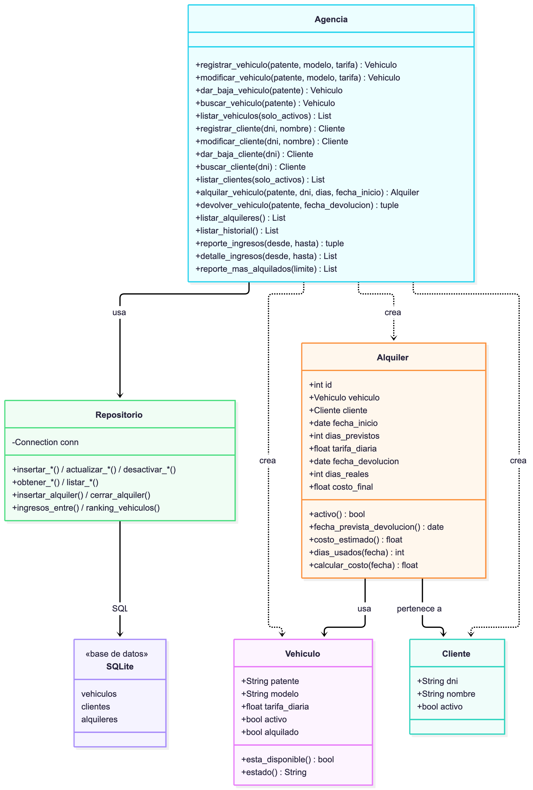
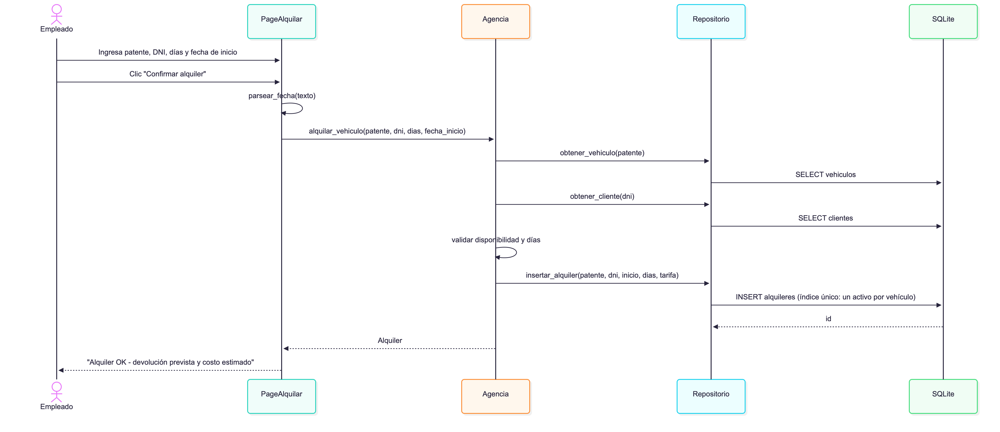
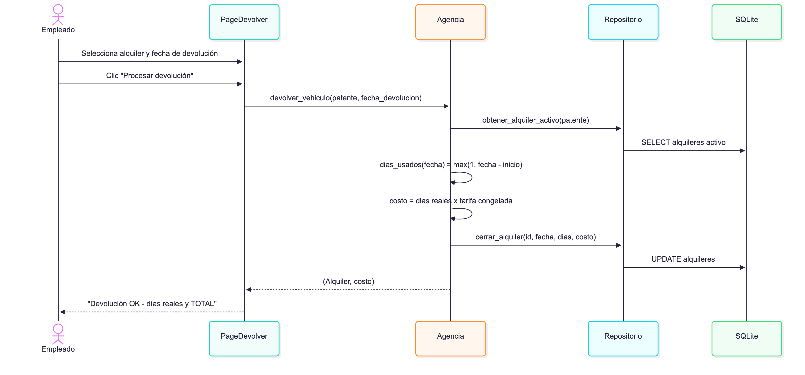
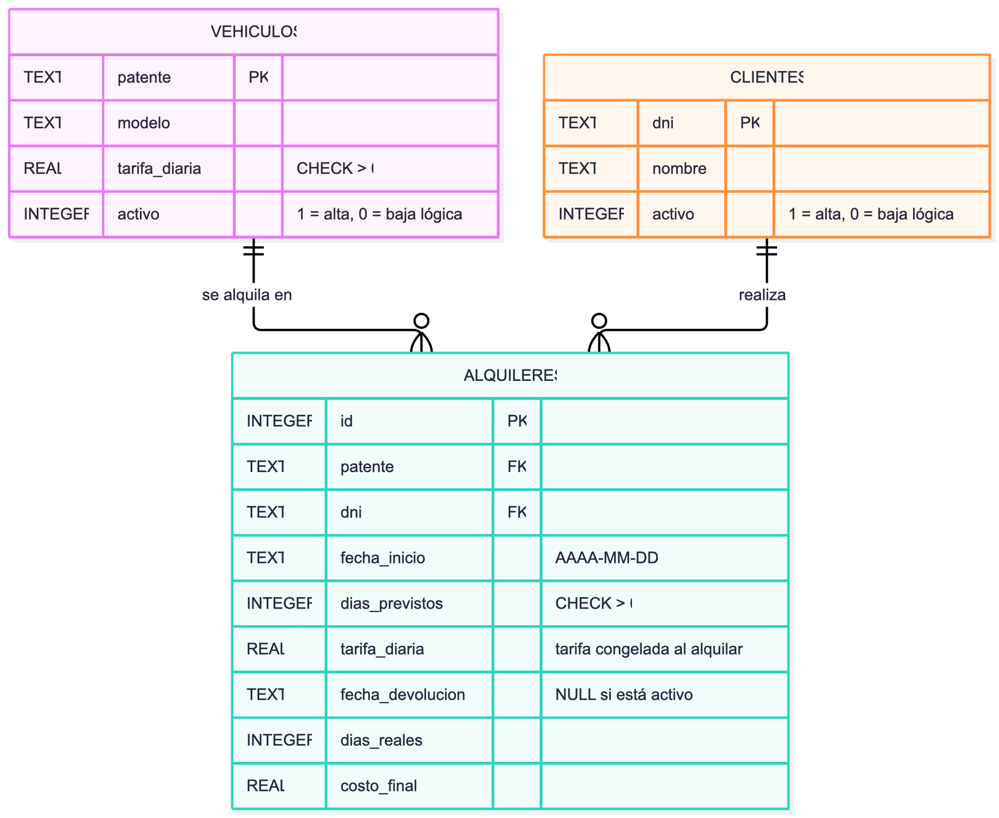

# AutoRent — Sistema de Alquiler de Vehículos

## Objetivo del software
AutoRent es una aplicación de escritorio desarrollada en Python para que una agencia de alquiler de
vehículos gestione su flota y sus clientes, registre alquileres y devoluciones, calcule el costo de cada
operación según los días realmente usados y conserve el historial en una base de datos SQLite.

## Requerimientos funcionales
- RF01: Registrar vehículos con patente, modelo y tarifa diaria.
- RF02: Modificar y dar de baja vehículos (baja lógica; no se permite con un alquiler activo).
- RF03: Registrar clientes con DNI y nombre.
- RF04: Modificar y dar de baja clientes (baja lógica; no se permite con un alquiler activo).
- RF05: Alquilar un vehículo disponible a un cliente, con fecha de inicio y días previstos.
- RF06: Procesar la devolución con fecha real y calcular el costo final (días reales, mínimo 1).
- RF07: Listar vehículos y clientes (con su estado).
- RF08: Consultar el historial de alquileres (activos y devueltos).
- RF09: Reporte de alquileres activos (indica los que tienen la devolución vencida).
- RF10: Reporte de ingresos por período, con detalle.
- RF11: Reporte de vehículos más alquilados.

## Requerimientos no funcionales
- RNF01: Interfaz gráfica de escritorio (CustomTkinter).
- RNF02: Validación de datos en todos los formularios.
- RNF03: Feedback visual inmediato ante errores o éxitos.
- RNF04: Ejecutable con Python 3.10 o superior.
- RNF05: Navegación por secciones sin recargar la aplicación.
- RNF06: Persistencia: los datos se conservan entre sesiones en un archivo SQLite local.
- RNF07: Integridad: un vehículo no puede tener dos alquileres activos (restricción en la base).

## Reglas de negocio
- Costo final = días reales × tarifa vigente al momento de alquilar. Días reales = fecha de devolución
  − fecha de inicio, con un mínimo de 1 día. La tarifa se congela al alquilar: modificarla después no
  cambia alquileres en curso.
- La fecha de inicio es editable (por defecto hoy), lo que permite cargar alquileres pasados.
- Las bajas son lógicas: el registro se oculta de las listas pero se conserva en el historial.
  Registrar de nuevo una patente o DNI dado de baja lo reactiva con los datos nuevos.

## Tecnologías utilizadas
- Python 3.10+
- CustomTkinter (interfaz gráfica)
- SQLite (módulo estándar `sqlite3`)
- `unittest` (pruebas)

## Arquitectura
Tres capas: interfaz → lógica de negocio → acceso a datos.

| Archivo | Rol |
|---|---|
| `main.py` | Punto de entrada y ventana principal. Carga datos de demo en la primera ejecución. |
| `ui.py` | Páginas de la interfaz (Vehículos, Clientes, Alquilar, Devolver, Historial, Reportes). |
| `componentes.py` | Colores, fuentes y componentes visuales reutilizables. |
| `modelo.py` | Entidades (Vehiculo, Cliente, Alquiler) y reglas de negocio (Agencia). |
| `repositorio.py` | Única capa que escribe SQL. |
| `db.py` | Conexión y esquema de la base SQLite. |
| `tests/` | Pruebas automatizadas. |
| `doc/` | Documentación: guía de uso, UML, modelo de datos y plan de pruebas. |

## Cómo ejecutar
```bash
pip install customtkinter
python main.py
```
La base `autorent.db` se crea sola junto al código. Detalles en [`doc/como_ejecutar.md`](doc/como_ejecutar.md).

## Pruebas
```bash
python -m unittest discover -s tests -t . -v
```
Resultados y casos en [`doc/plan_pruebas.md`](doc/plan_pruebas.md).

## Diagramas
Los diagramas están escritos en Mermaid (código en `doc/`); estas son las versiones en imagen.

### Casos de uso


### Clases


### Secuencia: alquilar un vehículo


### Secuencia: devolver un vehículo


### Modelo de datos


## Documentación
- [Guía de instalación y uso](doc/como_ejecutar.md)
- [Casos de uso](doc/uml_casos_uso.md) · [Clases](doc/uml_clase.md) · [Secuencia](doc/uml_secuencia.md)
- [Modelo de datos](doc/modelo_datos.md)
- [Plan de pruebas](doc/plan_pruebas.md)
