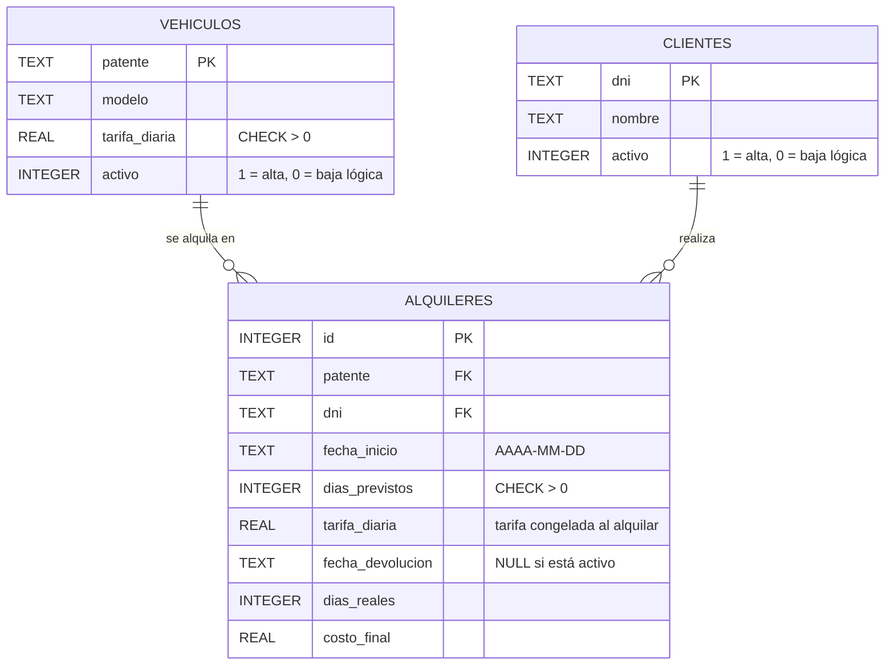

# Modelo de datos — AutoRent

Base de datos SQLite (`autorent.db`), creada automáticamente por `db.py`.

## Decisiones de diseño
- **Alquiler activo**: es el que tiene `fecha_devolucion` en `NULL`. El estado "alquilado" de un vehículo
  se deduce de eso y no se guarda, para que no pueda quedar inconsistente.
- **Un activo por vehículo**: lo garantiza un índice único parcial
  (`ux_alquiler_activo` sobre `patente` donde `fecha_devolucion IS NULL`).
- **Baja lógica**: `activo = 0` oculta el registro pero conserva las claves foráneas del historial.
- **Tarifa congelada**: `alquileres.tarifa_diaria` copia la tarifa del vehículo al alquilar.
- **Fechas**: se guardan en formato ISO (AAAA-MM-DD) y se muestran como dd/mm/aaaa.
